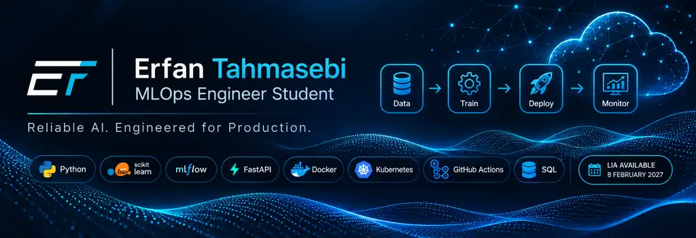
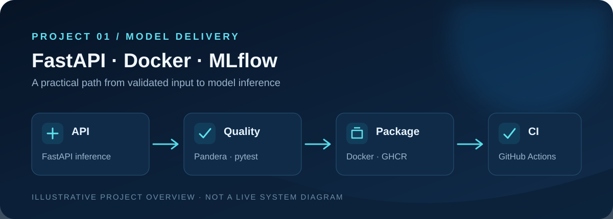
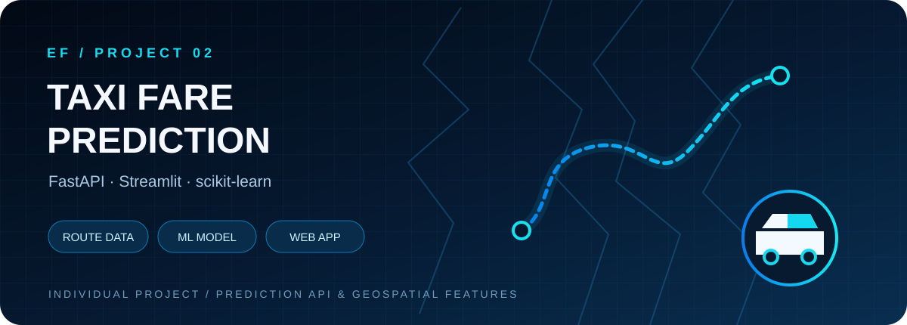
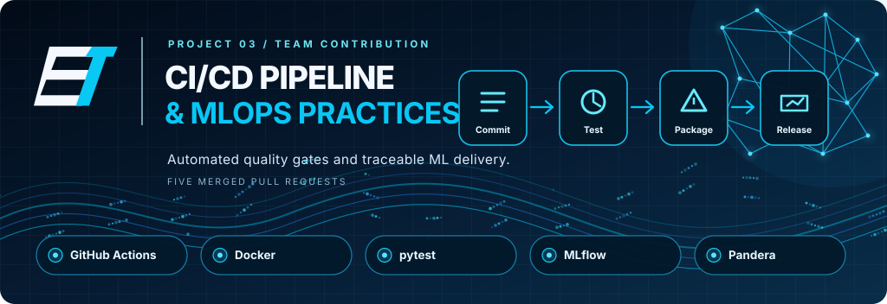

<!-- Profile README · Erfan Tahmasebi -->

 

# ERFAN TAHMASEBI

### MLOps Engineering Student  ·  Python  ·  Machine Learning Systems

**I build ML applications and the engineering workflows that make them reliable.**

Model serving · Data quality · CI/CD · Containers · Automation

 

  

---

**ABOUT** &nbsp; · &nbsp; **SELECTED WORK** &nbsp; · &nbsp; **TECH STACK** &nbsp; · &nbsp; **LIA 2027**

## 01 / About me

I'm an **MLOps Engineering student at Nackademin, Sweden (2025–2028)**. My interest is where machine learning meets software engineering: turning models into services that can be tested, packaged, monitored and delivered with confidence.

I enjoy building with Python and exploring the complete path from data validation and model development to APIs, containers and automated workflows.

<table>
<tr>
<td width="50%" valign="top">

**CURRENT FOCUS**

- ML model serving and REST APIs
- Data validation and automated testing
- CI/CD for ML applications
- Docker and Kubernetes fundamentals

</td>
<td width="50%" valign="top">

**WHAT I'M LOOKING FOR**

- LIA internship in Sweden
- 8 February – 21 May 2027
- A team working with data, ML or platform engineering
- Opportunities to contribute and learn

</td>
</tr>
</table>

Experience note: My experience is primarily academic and project-based. I distinguish individual projects from team contributions. My Kubernetes work is an individual educational deployment mini-project using kind and a course cluster—not professional production operations.

---

## 02 / Selected projects

Three projects showing individual application development, MLOps engineering and collaborative delivery.

<table>
<tr>
<td width="43%" valign="top">

</td>
<td valign="top">

### 01 — ML serving & deployment

**[fastapi-docker-ml-serving](https://github.com/erfantk25-lab/fastapi-docker-ml-serving)**

An educational MLOps project combining a customer-churn workflow, data checks, model evaluation, artifact lineage and a FastAPI inference service. The individual Kubernetes deployment mini-project is documented separately from collaborative pipeline work.

**Stack:** Python · FastAPI · scikit-learn · Pandera · MLflow · pytest · Docker · GitHub Actions · GHCR · Kubernetes / kind

[Explore repository →](https://github.com/erfantk25-lab/fastapi-docker-ml-serving)

</td>
</tr>
</table>

<table>
<tr>
<td width="43%" valign="top">

</td>
<td valign="top">

### 02 — Full-stack machine learning

**[taxi-prediction-fullstack-ERFAN](https://github.com/erfantk25-lab/taxi-prediction-fullstack-ERFAN)**

An individually developed taxi fare prediction application connecting a scikit-learn regression pipeline to a FastAPI service and Streamlit interface, with route data from OpenRouteService and a Folium map.

**Stack:** Python · FastAPI · Streamlit · scikit-learn · OpenRouteService · Folium · Joblib

[Explore repository →](https://github.com/erfantk25-lab/taxi-prediction-fullstack-ERFAN)

</td>
</tr>
</table>

<table>
<tr>
<td width="43%" valign="top">

</td>
<td valign="top">

### 03 — Team CI/CD & MLOps

**[ci-cd-pipeline](https://github.com/LeoLindqvist123/ci-cd-pipeline)**

Shared team project improving a customer-churn ML delivery pipeline. My contribution includes five merged pull requests covering Ruff in CI, model lineage, Docker packaging, Buildx optimisation and statistical data-drift checks.

**Stack:** Python · GitHub Actions · Docker · pytest · MLflow · Pandera · GHCR

[Explore team repository →](https://github.com/LeoLindqvist123/ci-cd-pipeline) · [My contribution summary](https://github.com/erfantk25-lab/erfantk25-lab.github.io/blob/main/projects/ci-cd-pipeline-contributions.md)

</td>
</tr>
</table>

[**VIEW ALL MY REPOSITORIES →**](https://github.com/erfantk25-lab?tab=repositories)

## 03 / Engineering workflow

The diagram below is a **conceptual map of practices explored across separate portfolio projects**. It is not a claim that every stage runs in one production system.

---

## 04 / Technical toolkit

Grouped by the role each technology plays in an ML application lifecycle.

<table>
<tr>
<td width="50%" valign="top">

**01 — PROGRAMMING & DATA**

**02 — MACHINE LEARNING**

**03 — BACKEND & SERVING**

</td>
<td width="50%" valign="top">

**04 — TESTING & CI/CD**

**05 — CONTAINERS & ORCHESTRATION**

**06 — DATA & VISUALISATION**

</td>
</tr>
</table>

**Currently developing:** cloud infrastructure, production monitoring and ML platform practices.

---

## 05 / More explorations

- [**Smart Grow — edge/IoT monitoring**](https://github.com/erfantk25-lab/Edge-computing-project-) — team project using Raspberry Pi Pico W, MicroPython, sensors, MQTT, TimescaleDB, Docker Compose and Grafana.
- [**MCP integration demo**](https://github.com/erfantk25-lab/nackademin-mcp-demo) — course demo exploring Model Context Protocol integration.
- [**LangChain demo**](https://github.com/erfantk25-lab/nackademin-langchain-demo) — course project exploring LangChain-based LLM application patterns.

[More context on my portfolio](https://erfantk25-lab.github.io/)

---

## 06 / LIA · Spring 2027

### Looking for an opportunity to grow as an MLOps Engineer

I'd be excited to contribute to a team working with:

**ML pipelines** &nbsp; · &nbsp; **Model serving** &nbsp; · &nbsp; **CI/CD** &nbsp; · &nbsp; **Data quality** &nbsp; · &nbsp; **Cloud & containers**

---

## 07 / Connect

**Interested in ML engineering, MLOps or internship opportunities? Let's connect.**

Erfan Tahmasebi · MLOps Engineering Student · Sweden

