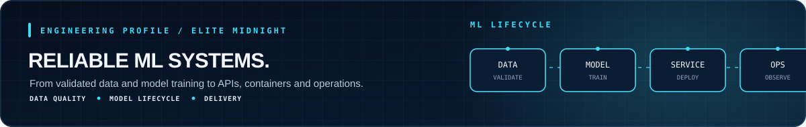
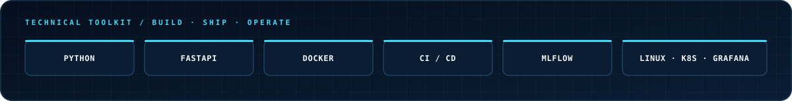
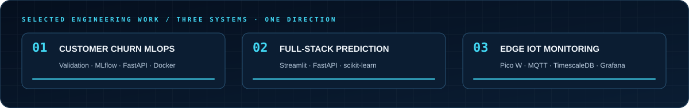
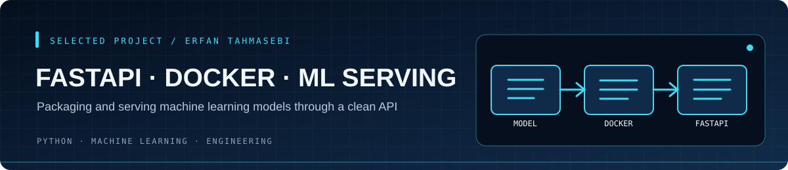
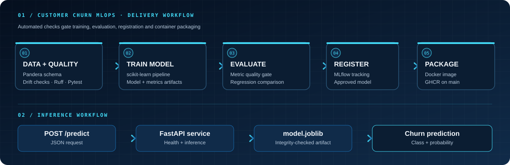
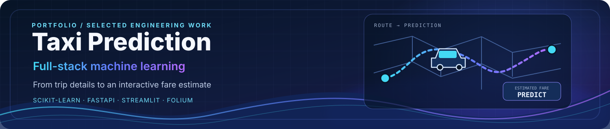
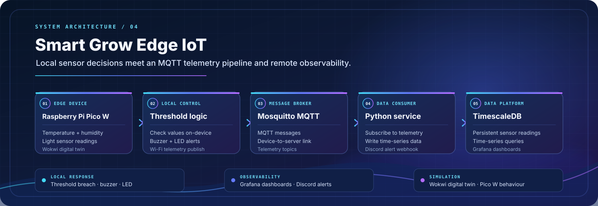
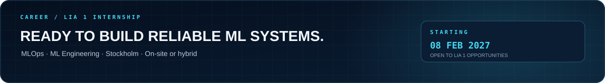

  

  

<h1 align="center">Erfan Tahmasebi</h1>

  <strong>MLOps Engineering Student · Stockholm, Sweden</strong> 
  Engineering reliable ML systems — from validated data and model training to APIs, containers and deployment.

  <a href="https://erfantk25-lab.github.io/">PORTFOLIO</a> &nbsp;·&nbsp;
  <a href="https://www.linkedin.com/in/erfan-tahmasbikondroodi/">LINKEDIN</a> &nbsp;·&nbsp;
  <a href="mailto:erfan.tahmasebi@gmail.com">EMAIL</a>

  
  
  

---

## Profile

I'm studying **MLOps Engineering at Nackademin**, focusing on the engineering practices that make machine learning applications reproducible, deployable and maintainable.

I enjoy connecting model development with practical software engineering: data validation, experiment workflows, model APIs, containerization, CI/CD and monitoring. The projects below show how I approach those problems through hands-on individual and collaborative work.

| Focus | What I'm building |
|---|---|
| **ML engineering** | Reproducible training, evaluation, model serving |
| **Platform & delivery** | Docker, CI/CD, GitHub Actions, container registries |
| **Data & reliability** | Schema validation, drift checks, tests and monitoring |
| **Edge & connected systems** | Device telemetry, MQTT pipelines and observability |

  

## Technical toolkit

  

  
  
  
  
  

---

  

## Selected work

Three projects, one engineering direction: build systems that move data reliably from source to useful outcomes.

### 01 / Customer Churn MLOps · Model serving & delivery

  

**[FastAPI Docker ML Serving](https://github.com/erfantk25-lab/fastapi-docker-ml-serving)**

An MLOps pipeline for customer churn prediction, combining data quality checks, model training and evaluation, artifact integrity, an inference API and Docker delivery.

- **Data quality:** Pandera schema validation and statistical drift checks.
- **Model lifecycle:** training, threshold evaluation, regression gate and optional MLflow tracking/registry.
- **Delivery:** FastAPI inference service, Docker image build, smoke tests and GitHub Actions CI/CD.
- **Reliability:** artifact checksum verification and automated tests.

  
  
  
  
  

<strong>Explore the system architecture</strong>

  

<a href="https://github.com/erfantk25-lab/fastapi-docker-ml-serving">VIEW PROJECT REPOSITORY →</a>

---

### 02 / Taxi Prediction · Full-stack machine learning

  

**[Taxi Prediction — Full Stack](https://github.com/erfantk25-lab/taxi-prediction-fullstack-ERFAN)**

An individual application that combines a regression model, a prediction API and an interactive geographic interface to estimate taxi fares from trip details.

- **Frontend:** Streamlit collects trip inputs and presents the prediction.
- **Route context:** OpenRouteService provides geocoding and driving-route information; Folium displays the route.
- **Inference:** FastAPI serves a scikit-learn regression pipeline and returns the predicted fare.
- **Model workflow:** candidate models are compared using RMSE; the selected pipeline and metadata are exported.
- **Quality:** GitHub Actions trains the model and runs API tests.

  
  
  
  
  

<strong>Explore the system architecture</strong>

  

<a href="https://github.com/erfantk25-lab/taxi-prediction-fullstack-ERFAN">VIEW PROJECT REPOSITORY →</a>

---

### 03 / Edge Computing · Smart Grow environmental monitor

  

**[Edge Computing Project](https://github.com/erfantk25-lab/Edge-computing-project-)**

A collaborative edge-IoT project using a Raspberry Pi Pico W to monitor environmental conditions, trigger local alerts and stream telemetry to a containerized monitoring stack.

- **At the edge:** temperature, humidity and light readings are checked locally; threshold breaches trigger a buzzer and LED.
- **Messaging:** the device publishes telemetry over Wi-Fi using MQTT through Mosquitto.
- **Data pipeline:** a Python consumer writes readings to TimescaleDB.
- **Observability:** Grafana visualizes time-series data; Discord webhooks deliver remote alerts.
- **Simulation:** a Wokwi digital twin complements the physical setup.

  
  
  
  
  

<strong>Explore the system architecture</strong>

  

<a href="https://github.com/erfantk25-lab/Edge-computing-project-">VIEW PROJECT REPOSITORY →</a>

---

  

## LIA 1 · Internship

  

I'm looking for an **LIA 1 placement** starting **8 February 2027**, preferably within **MLOps, ML Engineering or a closely related field**.

Based in Stockholm and open to on-site or hybrid opportunities. I'm eager to contribute to a team, learn from experienced engineers and help build reliable machine learning systems.

---

  

## Let's connect

  
  
  

BUILD WITH PURPOSE · AUTOMATE WITH CARE · IMPROVE CONTINUOUSLY

