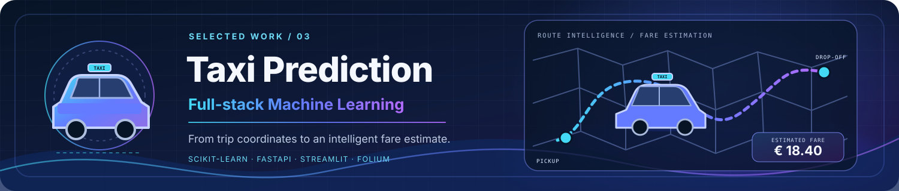

  

  <strong>MLOps Engineering Student · Stockholm, Sweden</strong> 
  Building reliable machine learning systems — from data quality and model training to APIs, containers and deployment.

  
  
  

  
  
  
  
  
  
  

---

## What I focus on

- **Machine learning systems** — data validation, model training and evaluation, experiment tracking, and inference APIs.
- **MLOps & delivery** — Docker, CI/CD, automated testing, reproducible workflows, and deployment fundamentals.
- **LLM & connected systems** — retrieval-augmented generation, evaluation and tracing, edge telemetry, and monitoring.

I enjoy connecting the pieces that make an ML application useful beyond a notebook: reliable inputs, measurable models, maintainable services, and repeatable delivery.

---

## Featured projects

### 01 · Customer Churn MLOps

  

**[FastAPI Docker ML Serving](https://github.com/erfantk25-lab/fastapi-docker-ml-serving)**

An end-to-end customer churn project focused on dependable model delivery, from data checks and model evaluation to a containerized prediction API.

- **Data quality:** Pandera schema validation and statistical drift checks.
- **Model lifecycle:** training, threshold evaluation, regression gate, and optional MLflow tracking.
- **Serving & delivery:** FastAPI, Docker, artifact checksum verification, automated tests, and GitHub Actions CI/CD.

  
  
  
  
  
  
  

### 02 · Study Buddy RAG

  

**[Fullstack LLMOps Project](https://github.com/LAjoyan/Fullstack_LLMops_Project)** · *Collaborative team project*

A full-stack Retrieval-Augmented Generation application that turns lecture transcriptions into an interactive study assistant for course questions, quizzes, flashcards, and PDF exports.

- **Retrieval:** LanceDB semantic search with Cohere multilingual embeddings and source-aware answers.
- **Application:** FastAPI, Streamlit, and Pydantic-AI agents.
- **LLMOps:** MLflow tracing, evaluation, and prompt versioning.
- **Delivery:** Docker Compose; also deployed to Azure App Service during development.

  
  
  
  
  
  
  
  

### 03 · Taxi Prediction — Full Stack

  

**[Taxi Prediction Full Stack](https://github.com/erfantk25-lab/taxi-prediction-fullstack-ERFAN)**

An application combining a regression model, prediction API, and interactive map to estimate taxi fares from trip details.

- **User experience:** Streamlit interface for trip inputs and predictions.
- **Geospatial data:** OpenRouteService for route information and Folium for map display.
- **Inference:** FastAPI serving a scikit-learn regression pipeline.
- **Quality:** model comparison using RMSE and automated checks with GitHub Actions.

  
  
  
  
  
  
  

### 04 · Edge Computing — Smart Grow

  

**[Edge Computing Project](https://github.com/erfantk25-lab/Edge-computing-project-)** · *Collaborative project*

An edge-IoT system using a Raspberry Pi Pico W to monitor environmental conditions, trigger local alerts, and stream telemetry to a monitoring stack.

- **Device:** sensor readings and local buzzer/LED alerts on threshold breaches.
- **Messaging & storage:** MQTT with Mosquitto, a Python consumer, and TimescaleDB.
- **Observability:** Grafana dashboards and Discord webhook alerts.
- **Simulation:** Wokwi digital twin.

  
  
  
  
  

---

## Technical toolkit

| Area | Tools and technologies |
|---|---|
| **Languages** | Python, SQL |
| **ML & data** | scikit-learn, Pandera, MLflow, LanceDB, Cohere |
| **APIs & apps** | FastAPI, Streamlit, Pydantic |
| **Delivery** | Docker, Git, GitHub Actions, Linux |
| **Cloud & monitoring** | Azure, Grafana, TimescaleDB, MQTT |

---

## LIA 1 · Internship

  

I am looking for an **LIA 1 placement starting 8 February 2027**, preferably within **MLOps, ML Engineering, or a related field**.

Based in **Stockholm, Sweden**, and open to on-site or hybrid opportunities. I am looking forward to learning from experienced engineers and contributing to practical, reliable software and ML systems.

---

## Let's connect

  
  
  

BUILD WITH PURPOSE · AUTOMATE WITH CARE · IMPROVE CONTINUOUSLY

