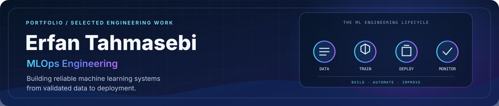

  

<h1 align="center">Erfan Tahmasebi</h1>

  <strong>MLOps Engineering Student · ML Systems · Model Serving · CI/CD</strong>

  Stockholm, Sweden ·
  <a href="https://erfantk25-lab.github.io/">Portfolio</a> ·
  <a href="https://www.linkedin.com/in/erfan-tahmasbikondroodi/">LinkedIn</a>

## Profile

I'm studying **MLOps Engineering at Nackademin** and building practical machine learning systems through individual and team projects. My focus is on the engineering around ML: validating data, serving models, packaging applications, and automating delivery workflows.

I enjoy taking a model beyond the experiment and making the surrounding system easier to run, test, and maintain. My experience so far is primarily project-based.

**Current focus:** Python · FastAPI · Docker · MLflow · GitHub Actions · Kubernetes fundamentals

## Selected projects

### 1. [FastAPI Docker ML Serving](https://github.com/erfantk25-lab/fastapi-docker-ml-serving)

An individual project focused on packaging and serving a machine learning model through an API.

- FastAPI-based model-serving workflow
- Containerization with Docker
- Input validation and model-serving practices

**Technologies:** Python, FastAPI, Docker, MLflow

### 2. [Taxi Prediction — Full Stack](https://github.com/erfantk25-lab/taxi-prediction-fullstack-ERFAN)

An end-to-end prediction application combining a machine learning model with an API and a user-facing interface.

- Scikit-learn model exposed through a FastAPI backend
- Streamlit frontend for interacting with predictions
- Geographic context using OpenRouteService and Folium

**Technologies:** Python, scikit-learn, FastAPI, Streamlit, Folium

### 3. [Edge Computing Project](https://github.com/erfantk25-lab/Edge-computing-project-)

A project exploring edge computing concepts and their practical implementation.

**Repository:** [Edge-computing-project-](https://github.com/erfantk25-lab/Edge-computing-project-)

## Areas I'm developing

- **ML engineering:** model serving, validation, experiment workflows
- **Platform & delivery:** Docker, CI/CD, GitHub Actions, container registries
- **Operations fundamentals:** Kubernetes, testing, monitoring concepts

## LIA 1 — Spring 2027

I'm looking for an **LIA 1 placement in MLOps, ML Engineering, or a closely related field**, starting **8 February 2027**. I'm based in Stockholm and interested in on-site or hybrid opportunities.

## Contact

- **Email:** [erfan.tahmasebi@gmail.com](mailto:erfan.tahmasebi@gmail.com)
- **LinkedIn:** [linkedin.com/in/erfan-tahmasbikondroodi](https://www.linkedin.com/in/erfan-tahmasbikondroodi/)
- **Portfolio:** [erfantk25-lab.github.io](https://erfantk25-lab.github.io/)

  Build · Validate · Deploy · Improve

