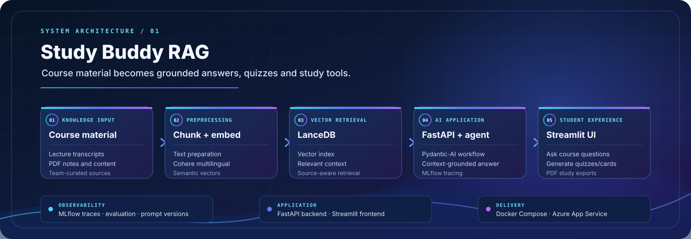
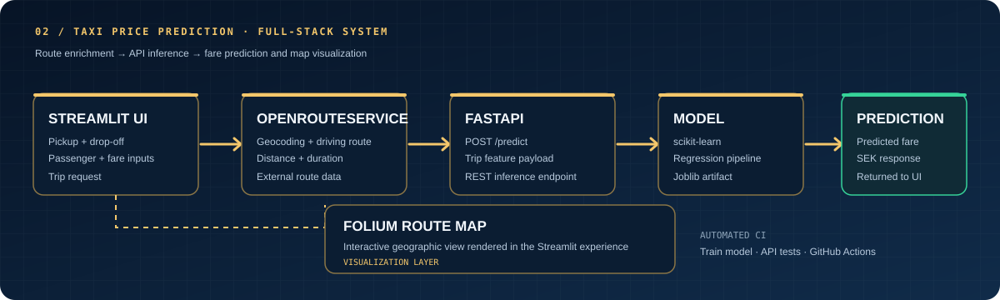
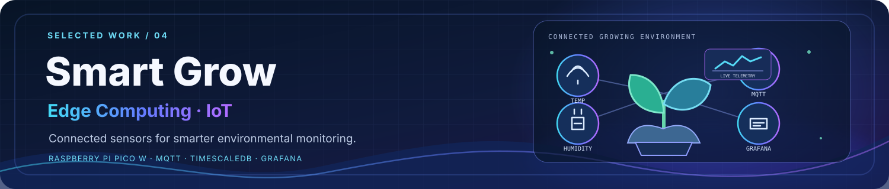

  

  <a href="https://erfantk25-lab.github.io/"><strong>Portfolio</strong></a>
  &nbsp;&nbsp;·&nbsp;&nbsp;
  <a href="https://www.linkedin.com/in/erfan-tahmasbikondroodi/"><strong>LinkedIn</strong></a>

---

## Selected work

Four projects, one engineering direction: build systems that move data reliably from source to useful outcomes.

### 01 / Study Buddy RAG · Full-stack LLMOps

  

**[Study Buddy RAG – Fullstack LLMOps Project](https://github.com/LAjoyan/Fullstack_LLMops_Project)**

A collaborative full-stack Retrieval-Augmented Generation (RAG) application built by a team of four. It turns lecture transcriptions into an interactive study assistant for course questions, quiz and flashcard generation, and PDF exports.

- **Retrieval:** semantic search with LanceDB and Cohere multilingual embeddings, with source-aware answers.
- **Application:** FastAPI backend, Streamlit frontend and Pydantic-AI agents.
- **LLMOps:** MLflow tracing, evaluation and prompt versioning.
- **Delivery:** Docker Compose; the project was also deployed to Azure App Service during development.

  
  
  
  
  
  
  
  
  

<strong>Explore the system architecture</strong>

  

<a href="https://github.com/LAjoyan/Fullstack_LLMops_Project">VIEW PROJECT REPOSITORY →</a>

---

### 02 / Customer Churn MLOps · Model serving & delivery

  

**[FastAPI Docker ML Serving](https://github.com/erfantk25-lab/fastapi-docker-ml-serving)**

An MLOps pipeline for customer churn prediction, combining data quality checks, model training and evaluation, artifact integrity, an inference API and Docker delivery.

- **Data quality:** Pandera schema validation and statistical drift checks.
- **Model lifecycle:** training, threshold evaluation, regression gate and optional MLflow tracking/registry.
- **Delivery:** FastAPI inference service, Docker image build, smoke tests and GitHub Actions CI/CD.
- **Reliability:** artifact checksum verification and automated tests.

  
  
  
  
  

<strong>Explore the system architecture</strong>

  

<a href="https://github.com/erfantk25-lab/fastapi-docker-ml-serving">VIEW PROJECT REPOSITORY →</a>

---

### 03 / Taxi Prediction · Full-stack machine learning

  

**[Taxi Prediction — Full Stack](https://github.com/erfantk25-lab/taxi-prediction-fullstack-ERFAN)**

An individual application that combines a regression model, a prediction API and an interactive geographic interface to estimate taxi fares from trip details.

- **Frontend:** Streamlit collects trip inputs and presents the prediction.
- **Route context:** OpenRouteService provides geocoding and driving-route information; Folium displays the route.
- **Inference:** FastAPI serves a scikit-learn regression pipeline and returns the predicted fare.
- **Model workflow:** candidate models are compared using RMSE; the selected pipeline and metadata are exported.
- **Quality:** GitHub Actions trains the model and runs API tests.

  
  
  
  
  

<strong>Explore the system architecture</strong>

  

<a href="https://github.com/erfantk25-lab/taxi-prediction-fullstack-ERFAN">VIEW PROJECT REPOSITORY →</a>

---

### 04 / Edge Computing · Smart Grow environmental monitor

  

**[Edge Computing Project](https://github.com/erfantk25-lab/Edge-computing-project-)**

A collaborative edge-IoT project using a Raspberry Pi Pico W to monitor environmental conditions, trigger local alerts and stream telemetry to a containerized monitoring stack.

- **At the edge:** temperature, humidity and light readings are checked locally; threshold breaches trigger a buzzer and LED.
- **Messaging:** the device publishes telemetry over Wi-Fi using MQTT through Mosquitto.
- **Data pipeline:** a Python consumer writes readings to TimescaleDB.
- **Observability:** Grafana visualizes time-series data; Discord webhooks deliver remote alerts.
- **Simulation:** a Wokwi digital twin complements the physical setup.

  
  
  
  
  

<strong>Explore the system architecture</strong>

  

<a href="https://github.com/erfantk25-lab/Edge-computing-project-">VIEW PROJECT REPOSITORY →</a>

---

## Technical toolkit

### Programming & ML

  

  
  

### MLOps & DevOps

  

  

### Data, messaging & observability

  

  
  

---

## LIA 1 · Internship

  

I'm looking for an **LIA 1 placement** starting **8 February 2027**, preferably within **MLOps, ML Engineering or a closely related field**.

Based in Stockholm and open to on-site or hybrid opportunities. I'm eager to contribute to a team, learn from experienced engineers and help build reliable machine learning systems.

---

## Let's connect

  
  
  

BUILD WITH PURPOSE · AUTOMATE WITH CARE · IMPROVE CONTINUOUSLY

