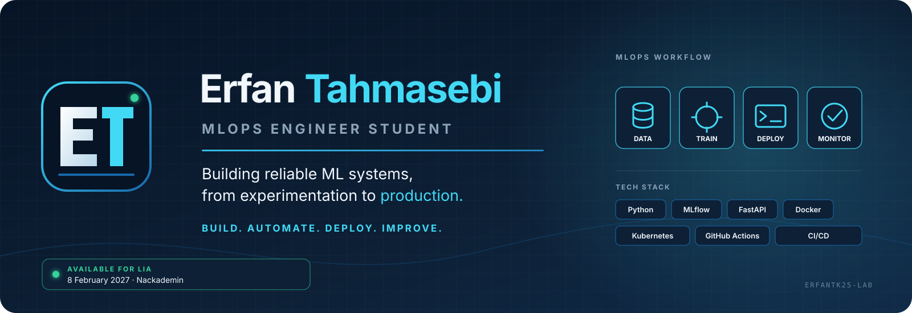
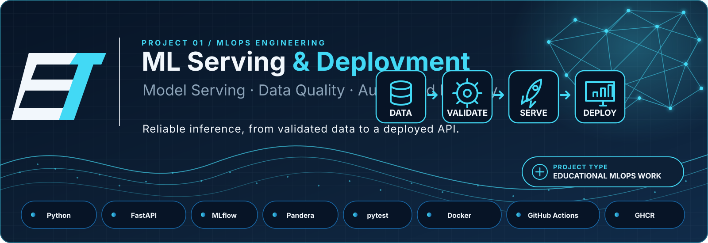
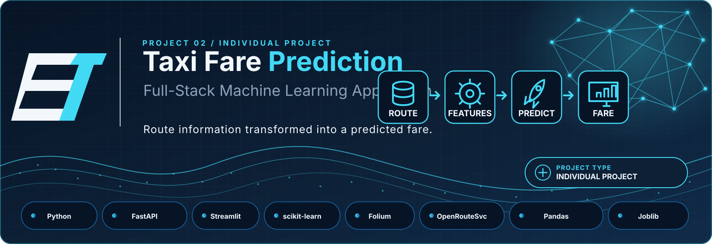
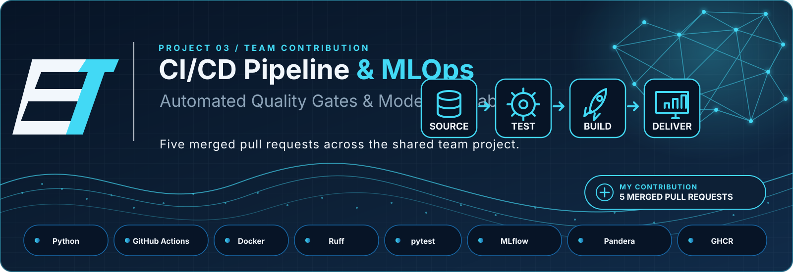

<!-- Profile README · Erfan Tahmasebi -->

 

# ERFAN TAHMASEBI

### MLOps Engineer Student · Python · Machine Learning Systems

**Building reliable ML systems, from experimentation to production.**

I connect machine learning, data quality and software engineering through practical projects in model serving, automation and deployment.

*Build. Automate. Deploy. Improve.*

 

  

**Available for LIA · 8 February – 21 May 2027 · Sweden**

---

## Featured work

Three projects that best represent the areas I am developing: ML serving and deployment, full-stack machine learning, and collaborative MLOps engineering.

### 01 · ML serving & deployment

**[fastapi-docker-ml-serving](https://github.com/erfantk25-lab/fastapi-docker-ml-serving)** · *Educational project with an individual Kubernetes mini-project*

A customer-churn ML workflow combining data validation, model evaluation, artifact lineage, a FastAPI inference service and container packaging. The individual Kubernetes deployment exercise is documented separately from collaborative pipeline work.

**Technologies:** Python · FastAPI · scikit-learn · Pandera · MLflow · pytest · Docker · GitHub Actions · GHCR · Kubernetes / kind

[Repository, architecture and setup →](https://github.com/erfantk25-lab/fastapi-docker-ml-serving)

---

### 02 · Full-stack machine learning

**[taxi-prediction-fullstack-ERFAN](https://github.com/erfantk25-lab/taxi-prediction-fullstack-ERFAN)** · *Individual project*

A taxi fare prediction application connecting a scikit-learn regression pipeline to a FastAPI service and Streamlit interface. OpenRouteService supplies route information and Folium displays the route.

**Technologies:** Python · FastAPI · Streamlit · scikit-learn · OpenRouteService · Folium · Joblib

[Repository, architecture and setup →](https://github.com/erfantk25-lab/taxi-prediction-fullstack-ERFAN)

---

### 03 · Team CI/CD & MLOps

**[ci-cd-pipeline](https://github.com/LeoLindqvist123/ci-cd-pipeline)** · *Shared team project*

A customer-churn ML delivery pipeline. My contribution includes **five merged pull requests** covering Ruff in CI, model lineage, Docker packaging, Buildx optimisation and statistical data-drift checks.

**Technologies:** Python · GitHub Actions · Docker · pytest · MLflow · Pandera · GHCR

[Team repository →](https://github.com/LeoLindqvist123/ci-cd-pipeline) · [My contribution summary →](https://github.com/erfantk25-lab/erfantk25-lab.github.io/blob/main/projects/ci-cd-pipeline-contributions.md)

[**EXPLORE ALL REPOSITORIES →**](https://github.com/erfantk25-lab?tab=repositories)

---

[ABOUT](#about) &nbsp; · &nbsp; [WORKFLOW](#engineering-workflow) &nbsp; · &nbsp; [TOOLKIT](#technical-toolkit) &nbsp; · &nbsp; [MORE EXPLORATIONS](#more-explorations) &nbsp; · &nbsp; [CONTACT](#connect)

## About

I'm an **MLOps Engineering student at Nackademin, Sweden (2025–2028)**. My interest is where machine learning meets software engineering: turning models into services that can be tested, packaged, monitored and delivered with confidence.

I enjoy building with Python and exploring the complete path from data validation and model development to APIs, containers and automated workflows.

| Current focus | What I'm looking for |
|---|---|
| ML model serving and REST APIs | LIA internship in Sweden |
| Data validation and automated testing | **8 February – 21 May 2027** |
| CI/CD for ML applications | A team working with data, ML or platform engineering |
| Docker and Kubernetes fundamentals | Opportunities to contribute and learn |

Experience note: My experience is primarily academic and project-based. I distinguish individual projects from team contributions. My Kubernetes work is an individual educational deployment mini-project using kind and a course cluster—not professional production operations.

---

## Engineering workflow

The diagram is a **conceptual map of practices explored across separate portfolio projects**. It does not imply that every stage runs in one production system.

---

## Technical toolkit

Grouped by the role each technology plays in an ML application lifecycle.

| Area | Tools and technologies |
|---|---|
| **Programming & data** | Python · SQL · Pandas · NumPy · Pandera |
| **Machine learning** | scikit-learn · MLflow |
| **Backend & serving** | FastAPI · REST APIs · Streamlit |
| **Testing & quality** | pytest · Ruff · API tests · smoke tests |
| **MLOps & CI/CD** | GitHub Actions · model evaluation · artifact lineage · GHCR |
| **Containers & orchestration** | Docker · Kubernetes fundamentals · kind |
| **Data & visualisation** | MQTT · TimescaleDB · Grafana · Folium |

**Currently developing:** cloud infrastructure, production monitoring and ML platform practices.

---

## More explorations

- [**Smart Grow — edge/IoT monitoring**](https://github.com/erfantk25-lab/Edge-computing-project-) — team project using Raspberry Pi Pico W, MicroPython, sensors, MQTT, TimescaleDB, Docker Compose and Grafana.
- [**MCP integration demo**](https://github.com/erfantk25-lab/nackademin-mcp-demo) — course demo exploring Model Context Protocol integration.
- [**LangChain demo**](https://github.com/erfantk25-lab/nackademin-langchain-demo) — course project exploring LangChain-based LLM application patterns.
- [**More portfolio context**](https://erfantk25-lab.github.io/)

---

## Connect

**Interested in ML engineering, MLOps or internship opportunities? Let's connect.**

Erfan Tahmasebi · MLOps Engineering Student · Sweden

