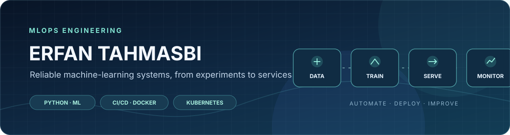

  <a href="https://erfantk25-lab.github.io/"><strong>Portfolio</strong></a> ·
  <a href="https://github.com/erfantk25-lab?tab=repositories"><strong>All projects</strong></a> ·
  <a href="mailto:erfan.tahmasbikondroodi@yh.nackademin.se"><strong>Contact</strong></a>

# Hi, I'm Erfan Tahmasbi 👋

**Junior MLOps Engineer | MLOps Engineering student at Nackademin · Sweden**

I build practical machine-learning systems, with a focus on reliable model serving, CI/CD automation, containerisation, and deployment.

I'm studying MLOps Engineering at Nackademin (2025–2028) and looking for an **LIA internship from 8 February to 21 May 2027**. I'm interested in helping engineering teams move ML workloads from experiments into dependable services.

- **Technical focus:** ML serving, CI/CD, Docker, Kubernetes, automated testing, and data quality
- **Individual project experience:** Python, FastAPI, Streamlit, scikit-learn, Docker, Kubernetes, kind, GitHub Actions, and SQL
- **MLOps tools:** MLflow, Pandera, pytest, GHCR

Kubernetes experience is from an **individual educational deployment mini-project** using kind and a course cluster. It includes Deployments, Services, health probes, resource requests/limits, rolling updates, and a GitHub Actions deployment workflow. This is project experience, not professional production experience.

---

## Featured projects

These are the three projects that best represent my current MLOps and ML engineering experience.

### 1. ML serving, Docker & Kubernetes
[**fastapi-docker-ml-serving**](https://github.com/erfantk25-lab/fastapi-docker-ml-serving) · [CI workflow](https://github.com/erfantk25-lab/fastapi-docker-ml-serving/actions/workflows/ci.yml)

FastAPI inference service and customer-churn MLOps workflow documented with Docker, MLflow, Pandera, pytest, GitHub Actions, and GHCR. This repository also documents my **individual Kubernetes deployment mini-project**. The customer-churn pipeline itself was collaborative; the Kubernetes mini-project is separately attributed as my individual work.

### 2. Taxi prediction — full-stack ML application
[**taxi-prediction-fullstack-ERFAN**](https://github.com/erfantk25-lab/taxi-prediction-fullstack-ERFAN)

Individually developed application with a FastAPI backend and Streamlit frontend, scikit-learn regression pipeline, OpenRouteService route data, and Folium map visualisation.

### 3. End-to-end MLOps & CI/CD — team project
[**Team CI/CD repository**](https://github.com/LeoLindqvist123/ci-cd-pipeline) · [My five merged PRs](https://github.com/erfantk25-lab/erfantk25-lab.github.io/blob/main/projects/ci-cd-pipeline-contributions.md)

I authored five merged pull requests covering Ruff in CI, model versioning and lineage, Docker packaging and smoke tests, multi-stage Docker/Buildx optimisation, and statistical data-drift checks. This is shared team work; the contribution summary documents my individual changes.

**More projects:** [Portfolio and project details](https://erfantk25-lab.github.io/) · [All GitHub repositories](https://github.com/erfantk25-lab?tab=repositories)

---

## Technical toolkit

  
  
  
  
  
  
  
  
  
  

| Area | Tools and technologies |
|---|---|
| Programming & data | Python, SQL, Pandera |
| Machine learning | scikit-learn, MLflow |
| Backend & model serving | FastAPI, REST APIs |
| Containers & CI/CD | Docker, GitHub Actions, GHCR, pytest |
| Kubernetes | kind, Deployments, Services, probes, rolling updates — individual educational project |
| Data & messaging | MQTT, TimescaleDB |
| Applications & visualisation | Streamlit, Grafana, Folium |
| Developing further | Cloud infrastructure, production monitoring, ML platform practices |

My experience is primarily academic and project-based. I distinguish individual implementation from team contributions and do not present educational deployments as professional production operations.

---

## Additional projects

### Smart Grow — team edge/IoT environmental monitoring
[**Edge-computing-project-**](https://github.com/erfantk25-lab/Edge-computing-project-)

Team project using Raspberry Pi Pico W, MicroPython, sensors, MQTT, Python, TimescaleDB, Docker Compose, and Grafana.

### MCP integration demo
[**nackademin-mcp-demo**](https://github.com/erfantk25-lab/nackademin-mcp-demo)

A focused course demo exploring Model Context Protocol integration.

### LangChain demo
[**nackademin-langchain-demo**](https://github.com/erfantk25-lab/nackademin-langchain-demo)

A course project exploring LangChain-based LLM application patterns.

---

## LIA internship

I'm looking for an internship where I can contribute and learn in areas such as:

- Building and maintaining data and ML pipelines
- Deploying and serving machine-learning models
- CI/CD and automation for ML applications
- Data validation, testing, and monitoring
- Containers, Kubernetes, infrastructure, and cloud workflows

**Period:** 8 February – 21 May 2027

## Contact

- **Email:** [erfan.tahmasbikondroodi@yh.nackademin.se](mailto:erfan.tahmasbikondroodi@yh.nackademin.se)
- **Portfolio:** [erfantk25-lab.github.io](https://erfantk25-lab.github.io/)
- **GitHub:** [@erfantk25-lab](https://github.com/erfantk25-lab)

---
*Thanks for visiting my profile!*
