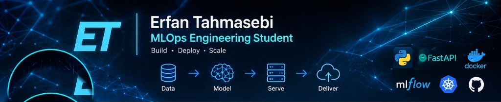

  

### 👨‍💻 About

I am an **MLOps Engineering Student** at **Nackademin**, passionate about building reliable machine learning systems, deploying scalable solutions, and working with modern technologies like Python, FastAPI, Docker and Kubernetes.

- 🔭 **Current Focus**: Machine Learning Serving, Automated CI/CD Pipelines & Cloud Architecture
- ⚙️ **Core Stack**: Python, Docker, Kubernetes, FastAPI, MLflow, GitHub Actions
- 🎓 **Education**: MLOps Engineering at Nackademin, Stockholm, Sweden
- 🌐 **Portfolio & Projects**: [github.com/erfantk25-lab](https://github.com/erfantk25-lab)
- 📫 **Contact**: [erfan.tahmasebi@gmail.com](mailto:erfan.tahmasebi@gmail.com) • [LinkedIn](https://www.linkedin.com/in/erfan-tahmasbikondroodi/)

---

### 🛠️ Tech Stack

  
  
  
  
  
  

---

### 📌 Pinned Repositories Overview

| Repository | Description | Tech Stack |
| :--- | :--- | :---: |
| 🚕 **[taxi-prediction-fullstack-ERFAN](https://github.com/erfantk25-lab/taxi-prediction-fullstack-ERFAN)** | Taxi fare prediction with ML, FastAPI and Streamlit | Python, FastAPI, Streamlit |
| 🐳 **[fastapi-docker-ml-serving](https://github.com/erfantk25-lab/fastapi-docker-ml-serving)** | ML model serving with FastAPI, Docker and CI/CD | Python, FastAPI, Docker |
| 🔄 **[ci-cd-pipeline](https://github.com/erfantk25-lab/CI-CD-pipeline)** | CI/CD pipeline for machine learning projects | Python, GitHub Actions |
| 🌐 **[Edge-computing-project-](https://github.com/erfantk25-lab/Edge-computing-project-)** | Edge AI and IoT project | Python, Edge AI, IoT |
| 📦 **[nackademin-mcp-demo](https://github.com/erfantk25-lab/nackademin-mcp-demo)** | MCP demo with Python | Python, MCP Protocol |
| 🔗 **[nackademin-langchain-demo](https://github.com/erfantk25-lab/nackademin-langchain-demo)** | LangChain demo application | Python, LangChain |

---

  
  

 

  Build • Deploy • Scale | © 2026 Erfan Tahmasebi

